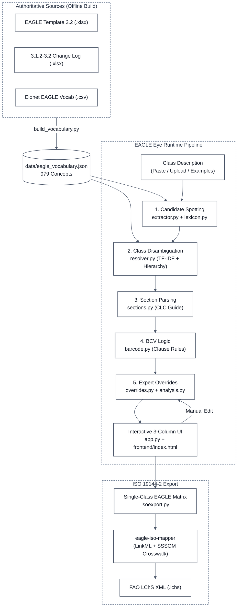

# Technical Report: Implementation of the EAGLE AI Prototype ("EAGLE Eye")

**Project:** EAGLE — Task 8: Exploration of AI  
**Task Leader:** Gregor Rosenauer (UBA)  
**Involved Partners:** CNIG, GISAT, NILU, space4environment, Stephan Arnold, WENR  
**Reference Specification:** `Spec.md` (Task 8: Exploration of AI)  
**Deliverable:** Prototype Implementation Technical Report  
**Date:** 25 November 2026  

---

## 1. Executive Summary

This report documents the design, implementation, and empirical evaluation of **EAGLE Eye**, the functional prototype developed under **Task 8 (Exploration of AI)** of the EAGLE project. Originating from the requirements defined in [`Spec.md`](../Spec.md), EAGLE Eye addresses a core bottleneck in European land monitoring: translating unstructured, narrative land cover and land use class descriptions (such as CORINE Land Cover legends, national nomenclatures, and field guides) into structured **EAGLE bar codes**—combinations of Land Cover Components (**LCC**), Land Use Attributes (**LUA**), and Land Characteristics (**LCH**) with formal Bar Code Values (**BCV**)—and bridging them seamlessly to the **ISO 19144-2 Land Characterization System (LChS)** standard.

### Key Achievements

* **End-to-End Interactive Prototype:** Delivered a web-based workspace (`app.py`, Streamlit + custom interactive HTML/JS component) that highlights EAGLE concepts directly inside free-text class descriptions, resolves concrete EAGLE v3.2 elements with confidence scores and human-readable rationales, proposes clause-level Bar Code Values (`X`, `1`–`5`), supports full human-in-the-loop expert review and correction, and exports valid **ISO 19144-2 LChS XML (`.lchs`)** directly importable into the FAO LChS Tool.
* **Transparent, Methodologically Faithful Architecture:** Rather than relying on an opaque Large Language Model (LLM) prone to hallucinating unstated land cover concepts, the prototype implements a **deterministic, explainable hybrid NLP and semantic retrieval pipeline**. This directly enforces the EAGLE Bar Coding Manual (D3-1a) rule that *only explicit textual wording counts*—every automated proposal is traceable to its source text span, Eionet definition, thematic domain context, and logical clause cue.
* **Unified Machine-Readable Knowledge Base:** Consolidated three authoritative EAGLE sources (EAGLE Barcoding Template 3.2, the 3.1.2→3.2 Change-Log Workbook, and the published Eionet EAGLE Vocabulary) into a reproducible JSON knowledge base covering all **979 EAGLE v3.2 elements** (56 LCC, 136 LUA, 787 LCH).
* **Standards-Based ISO 19144-2 Interoperability:** Integrated with the companion transformation engine (`eagle-iso-mapper`), which uses **LinkML** schemas and an **SSSOM** (Simple Standard for Sharing Ontological Mappings) crosswalk as a machine-readable semantic bridge. Upstream schema extensions—most notably adding a `Precluded` presence type for BCV `X` and supporting LUA/LCH/irrigation code lists—ensure faithful round-trip semantics with the FAO LChS Tool.
* **Verified Quality & Empirical Benchmarking:** Backed by **126 passing automated tests** (covering the worked *Natural Grassland* benchmark from the manual, CLC guide sections, lexical variants, expert overrides, and XML export) and quantitatively benchmarked against all **44 CORINE Land Cover (CLC) classes** from the CLCplus Core barcoding library (`eagle-barcoding-results`).

Items outside the current prototype scope—including LLM hybridization, multilingual translation, batch nomenclature cross-walking, institutional production deployment, formal handover, and user trainings—are itemized separately in the **[Annex](#annex-outstanding-items-and-follow-up-work-packages)**.

---

## 2. Requirements Traceability Against `Spec.md`

The table below maps each objective and proposed capability in [`Spec.md`](../Spec.md) to its implementation status in the delivered prototype.

| `Spec.md` Objective / Capability | Target Scope | Current Status | Implementation Summary & Evidence |
| --- | --- | --- | --- |
| **1. Automated Semantic Bar-coding** | Read textual class descriptions; suggest EAGLE elements and BCVs; understand hierarchy and multi-element BCVs (Task 7 support) | **Implemented (Core)** | 5-stage NLP/IR pipeline (`extractor.py`, `resolver.py`, `sections.py`, `barcode.py`, `analysis.py`) over all 979 EAGLE v3.2 concepts; hierarchy-aware resolution; clause-level BCV assignment (`X`, `1`–`5`); lone-`2` check; human-in-the-loop overrides (`overrides.py`). |
| **2. EAGLE ↔ ISO 19144-2 Semantic Alignment & Bi-directional Crosswalk** | Formalized machine-readable mapping (SKOS or comparable standard) between EAGLE and ISO 19144-2 (LCML/LChS); bi-directional translation (Task 3 link) | **Implemented (via Companion Engine)** | `eagle_eye/isoexport.py` generates a single-class EAGLE matrix and delegates to `eagle-iso-mapper`, which implements a **LinkML** data model and **SSSOM** crosswalk (a W3C/OBO-aligned machine-readable equivalent to SKOS). Produces FAO-compatible `.lchs` XML; reverse ISO → EAGLE translation is provided by `eagle-iso-mapper`. |
| **3. Leverage Existing Bar-coded CLMS Products as Context** | Use existing EAGLE bar-coded CLMS products (e.g., CLC) as reference context | **Implemented (Benchmark & Advisory)** | Evaluated against all 44 CLCplus Core bar-coded CLC classes (`scripts/evaluate_library.py`); empirically measured divergence in list-section BCVs is surfaced directly in the UI as *"CLCplus practice"* advisory notes. |
| **4. Multilingual Nomenclature Translation** | Automatically interpret/translate national definitions from local languages into English (Task 4, 7, 9 support) | **Not Yet Implemented** | Current pipeline operates on English text (Snowball English stemmer + English curated lexicon). Tracked in [Annex A.2](#a-functional-and-research-gaps-against-specmd). |
| **5. Nomenclature-to-Nomenclature Cross-walking** | Automated similarity matching ("assign most similar classes from nomenclature A to B") across national/regional systems (e.g., EUNIS) | **Foundation Laid / Not Yet Implemented** | Single-class decomposition into harmonized EAGLE + ISO representations is operational; automated cross-nomenclature similarity ranking and batch processing are tracked in [Annex A.3](#a-functional-and-research-gaps-against-specmd). |
| **6. Enhancing EO Image Classification** | Use EAGLE-annotated products as deep-learning training data for remote sensing (Task 1 sustainability) | **Out of Prototype Scope** | Downstream strategic objective enabled by standardized semantic outputs; tracked in [Annex A.7](#a-functional-and-research-gaps-against-specmd). |
| **7. CLCplus Core Integration, GIS Agentic Workflows & User Support** | Direct connection to CLCplus Core, ArcGIS/QGIS agentic workflows, and training/outreach support (Task 4 & 9) | **Partially Addressed (Standalone Web App)** | Standalone hosted demo ready (password gate, dynamic examples, progressive loading); direct API integration with CLCplus Core, GIS plugins, and training materials are tracked in [Annex A.6](#a-functional-and-research-gaps-against-specmd) and [Annex B](#b-operational-deployment-handover-and-training-covered-separately). |

---

## 3. System Architecture and Data Engineering

### 3.1 End-to-End Architecture

EAGLE Eye follows a clean separation of concerns between **knowledge preparation** (offline, reproducible build), **interactive semantic analysis** (runtime pipeline + human-in-the-loop UI), and **standards-compliant XML serialization** (delegated to `eagle-iso-mapper`).

*Figure 1: End-to-end architecture of the EAGLE Eye prototype, from offline EAGLE v3.2 vocabulary consolidation through the five-stage interactive semantic pipeline to ISO 19144-2 LChS XML export via `eagle-iso-mapper`.*

### 3.2 Knowledge Base Engineering (`scripts/build_vocabulary.py`)

To avoid hard-coding domain taxonomies inside application logic, a dedicated preprocessing pipeline merges three authoritative EAGLE artifacts into a single machine-readable file (`data/eagle_vocabulary.json`, ~571 KB):

1. **EAGLE Barcoding Template 3.2** (`EAGLE Barcoding Template_3.2_20230829.xlsx`): Supplies the authoritative catalog of **979 elements** (**56 LCC**, **136 LUA**, **787 LCH**), including canonical URIs, element codes, official labels, and hierarchical depth levels.
2. **EAGLE Matrix 3.2 Change-Log Workbook** (`Old3.1.2-New3.2_20240606_corr.xlsx`): Contributes structural element classifications (*Heading*, *Character*, *Parameter*) and Land Cover / Land Use (*LC/LU/Gen*) relevance flags.
3. **Eionet EAGLE Vocabulary** (`dd.eionet.europa.eu/vocabulary/landcover/eagle`, CSV): Enriches every element with formal semantic definitions, *Includes* examples, *Excludes* constraints, thematic domain tags (e.g., `AGRI`, `FRST`, `HABT`, `URBN`, `TRNS`), and parameter measurement units. When no local CSV is supplied, the build script retrieves the latest published version directly from Eionet.

During ingestion, the build script repairs legacy Windows-1252 (`cp1252`) encoding artifacts and reconstructs explicit parent-child trees directly from structured element codes (e.g., `LCC-2_1_1` → parent `LCC-2_1`).

---

## 4. Technical Implementation of the Semantic Pipeline

### 4.1 Design Rationale: Explainable Hybrid NLP vs. Unconstrained LLMs

A central finding during early prototyping was that the **EAGLE Bar Coding Manual (D3-1a)** imposes a strict evidentiary standard: *only concepts explicitly stated in a class description may be bar-coded; nothing may be inferred from world knowledge*. Unconstrained generative LLMs routinely violate this rule by extrapolating implicit ecological or infrastructural attributes and struggle to provide deterministic, auditable rationales for individual BCVs.

Consequently, EAGLE Eye was engineered as a **modular, deterministic 5-stage pipeline** (~1,810 LOC across 14 Python modules in `eagle_eye/`) where every decision retains structured provenance:

1. **Stage 1 — Candidate Spotting (`extractor.py`, `lexicon.py`, `textnorm.py`):**
   * Pools two complementary sources of lexical evidence:
     * **Curated Lexicon (`lexicon.py`):** 65 auditable regex rules (20 LCC, 14 LUA, 31 LCH) bridging everyday descriptive phrasing (*"rocky areas"*, *"no human influence"*, *"arable land"*, negated management lists like *"(not drained, irrigated, sown, fertilized)"*, and numerical parameter thresholds such as *"more than 50 %"* or height/area ranges) that do not appear verbatim in official matrix labels.
     * **Automatic Vocabulary Matching (`vocabulary.py`, `extractor.py`):** Scans all 979 EAGLE labels and their non-heading compound parts using case-insensitive Snowball English stemming (`snowballstemmer`), British/American spelling normalization (*fertilised* = *fertilized*), and compound-head decomposition (*grassland* → *grass*).
   * Overlapping candidate spans are resolved deterministically by favoring the longest, highest-scoring non-overlapping spans (e.g., *shrub clearance* beats *shrub*).
   * Generic stopwords (e.g., *land*, *area*, *natural*, *cover*) are filtered to prevent false positives from label fragments.

2. **Stage 2 — Concrete Class Disambiguation (`resolver.py`):**
   * Resolves ambiguous surface spans (such as *mowing* or *herbaceous*) to concrete EAGLE concepts using four combined signals:
     * **TF-IDF Definition Retrieval (`DefinitionIndex`):** Builds L2-normalized TF-IDF vectors over each concept's label (weighted 3×), Eionet definition, and *Includes* examples, ranking candidates by cosine similarity against the span and its surrounding sentence.
     * **Hard *Excludes* Vetoes:** Applies Eionet *Excludes* notes as strict negative constraints (e.g., preventing *reeds* from resolving to *"Grasses, Sedges, Rushes, Cereals"*).
     * **Whole-Text Context:** Aggregates thematic domains (`AGRI`, `FRST`, `URBN`, etc., weighted inversely by domain ambiguity) and active concept families across the full description so all morphological variants of a term (e.g., *Grassland* vs. *grasslands*) receive consistent resolution and confidence scores (`high` ≥ 0.70, `medium` ≥ 0.50, `low` < 0.50).
     * **Hierarchy Enforcement:** Structural *Headings* cannot characterize a land unit; the resolver maps heading hits to their *"applied / present, unspecified"* sibling and descends into more specific child nodes only when the text explicitly names distinguishing criteria (e.g., *extensive grazing* → *"Extensive, Freerange Grazing"*).

3. **Stage 3 — Section-Aware Document Interpretation (`sections.py`):**
   * Recognizes the standardized section headings of the **CLC2018 Nomenclature Illustrated Guide** and adjusts semantic interpretation accordingly:
     * *This class is not applicable for:* / *This class excludes:* → assigns BCV `X` (excluded), **unless** the same element is positively claimed elsewhere in the class description, in which case the mention is muted (rendered dotted grey, excluded from bar-coding) because it merely describes a contrasting class.
     * *Generalisation:* → treated as cartographic mapping guidance (e.g., 25 ha minimum mapping unit, minimum widths), muted and excluded from bar-coding.
     * *Particularities:* / *Particularity of class …:* → interpreted as optional special cases (BCV `1`), including nested sub-headings.
     * *Applicable for:* and *Includes:* → tracked as structural list sections to enable advisory comparison against CLCplus Core barcoding practice.

4. **Stage 4 — Clause-Level Bar Code Value Inference (`barcode.py`):**
   * Splits descriptions into logical clauses (respecting abbreviations like `e.g.` and soft breaks such as *but*, *however*, *whereas*) and groups coordinated elements (*and*, *or*, commas) so they share logical operators:
     * `X` (*excluded*): negation cues (*not*, *without*, *excludes*, *free of*, negated management lists).
     * `1` (*optional*): qualifying cues (*frequently*, *often*, *e.g.*, *such as*, *also occur*, *tolerated*, modals *may*/*can*).
     * `2` (*selective mandatory*): disjunctive clauses (*A or B*, *either A or B*).
     * `3` (*cumulative mandatory*): conjunctive clauses (*A and B*) or unqualified plain statements (explicitly flagged as **assumed**).
     * `4` (*paired mandatory*): threshold clauses (*at least two of A, B, C*).
     * `5` (*exclusive mandatory*): exclusivity cues (*only*, *exclusively*).
   * **Integrity Checks (`analysis.py`):** Flags any lone BCV `2` (since selective mandatory values require at least one partner per the manual) without silently deleting it, and attaches *"CLCplus practice"* tooltips to plainly stated list elements where historical CLCplus barcodes diverged from the manual's default `3`.

5. **Stage 5 — Human-in-the-Loop Expert Refinement (`overrides.py`, `analysis.py`):**
   * Domain experts can reassign any highlight's EAGLE class (via a searchable picker prioritizing nearest hierarchical relatives and resolver alternatives marked with `★`), manually adjust any BCV, dismiss false positives, or select arbitrary unhighlighted text to add a new manual annotation.
   * All edits are stored as span-anchored `Override` records (`replace`, `bcv`, `remove`, `add`) layered deterministically on top of the automatic analysis. If the user edits the source text, `reanchor()` automatically tracks overrides to their nearest surviving text occurrence and notifies the user if any wording was deleted.

### 4.2 Bi-Directional ISO 19144-2 Export Architecture (`isoexport.py` & `eagle-iso-mapper`)

An early approach that serialized custom XML directly inside EAGLE Eye was deliberately retired in favor of a decoupled integration with the companion prototype **`eagle-iso-mapper`**:

* **Single Source of Truth:** `eagle_eye/isoexport.py` formats the finalized analysis (all bar-coded LCC, LUA, and LCH elements, with positive mentions taking precedence over conflicting exclusions) into an in-memory **single-class EAGLE barcoding matrix** (vertical Excel layout, ordered by matrix sequence with URI, Code, Label, Level, and Barcode columns) and invokes `eagle-iso-mapper`'s `run_eagle_to_iso_mapping` entry point.
* **Formalized Semantic Crosswalk:** All EAGLE ↔ ISO 19144-2 translation rules reside centrally in `eagle-iso-mapper`'s **LinkML** schema (`eagle-iso-mapping.linkml.yaml`) and **SSSOM** crosswalk (`eagle_iso_sssom.yaml`), keeping semantic governance out of application code and ensuring compatibility with the reverse ISO → EAGLE direction.
* **FAO LChS Tool Compatibility:** Coordinated upstream enhancements in `eagle-iso-mapper` (commits `6e47820` through `01f8fdb`) aligned block vocabularies, irrigation code lists, numeric join IDs, `.lchs` file extensions, and introduced a **`Precluded` presence type** so EAGLE BCV `X` (excluded) is no longer misrepresented as ISO *Exclusive*.
* **Non-Blocking Startup:** Because importing LinkML and SSSOM libraries adds startup latency on constrained servers, `isoexport.warm_up()` loads the mapper in a background daemon thread at app startup while a Streamlit `@st.fragment` polls readiness every 2 seconds in the export popover.

### 4.3 User Interface and Hosted Demo Readiness (`app.py`, `frontend/index.html`, `auth.py`)

* **Three-Column Interactive Workspace:** Pairs the color-coded annotated text pane (left: green = LCC, purple = LUA, gold = LCH) with a compact, collapsible resolved-class pane (middle, displaying confidence indicators, BCV badges, Eionet definitions, and decision rationales) and a full tabular audit log of every highlight (right, including section context, CLCplus practice notes, and runner-up alternatives).
* **Bidirectional Synchronization:** Implemented via a lightweight custom frontend component (`eagle_eye/frontend/index.html`, 462 LOC) supporting click-to-highlight synchronization, auto-expanding class panels, double-underlined manual edits, and drag-to-select manual annotation.
* **Hosted Deployment Controls:** Includes an optional constant-time shared password gate (`eagle_eye/auth.py`, enabled via `APP_PASSWORD`, open by default for local runs), dynamic hot-reloaded example descriptions from `config/examples/` (overridable via `EAGLE_EYE_EXAMPLES_DIR`), compact `.txt`/`.md` file upload, and progressive loading spinners.

---

## 5. Development Progression and Milestones

Git history shows an iterative, milestone-driven delivery from initial proof of concept to hosted demo readiness between **22 October 2026** and **25 November 2026** (20 commits in `eagle-eye`, coordinated with `eagle-iso-mapper` and `eagle-barcoding-results`):

| Phase | Date | Key Milestones & Capabilities Delivered |
| --- | --- | --- |
| **Iteration 1 (v0.1)** | 22 Oct 2026 | Initial Streamlit prototype, EAGLE v3.2 vocabulary build script, LCC/LUA/LCH extraction, inline highlighting, bidirectional click sync. |
| **Iteration 2 (v0.2)** | 22 Oct 2026 | Context-aware concrete class disambiguation (`resolver.py`), TF-IDF definition index, confidence scores, rationales, collapsible auto-scrolling class panels. |
| **Iteration 3 (v0.3.0)** | 22 Oct 2026 | Human-in-the-loop manual overrides (`overrides.py`), automated BCV inference (`barcode.py`), ISO 19144-2 LChS XML export via `eagle-iso-mapper`, `Precluded` presence type fix. |
| **UX Refinement (v0.3.1)** | 27 Oct – 11 Nov 2026 | Three-column workspace layout, compact class pane, help bubbles, presentation screenshots, dynamic `config/examples/` loader. |
| **CLC Guide & NLP Hardening (v0.3.2–0.3.3)** | 10–12 Nov 2026 | CLC Illustrated Guide section parser (`sections.py`), Snowball English stemming, spelling/compound normalization, *human influence* rule set, process documentation (`docs/process.md`). |
| **ISO Alignment & Benchmarking** | 12–25 Nov 2026 | Full LUA/LCH/irrigation XML export, FAO LChS numeric ID & `.lchs` compatibility, 44-class CLC library evaluation (`evaluate_library.py`), CLCplus practice advisory notes, lone-BCV-`2` diagnostics, CLC 1.2.4 Airports example, hosted demo password gate & progressive loading. |

---

## 6. Verification, Testing, and Empirical Evaluation

### 6.1 Automated Regression Test Suite

The prototype is verified by **126 automated tests** across 8 test modules (`uv run pytest` — **126 passed, 0 failed** in ~21s):

* **`test_extractor.py` & `test_resolver.py`:** Validate span spotting, overlap resolution, TF-IDF disambiguation, *Excludes* vetoes, hierarchy descent, and vocabulary code integrity for all 65 lexicon rules.
* **`test_barcode.py`:** Verifies clause-level logical inference (`X`, `1`–`5`), negation propagation, and reproduces the **EAGLE Bar Coding Manual's worked *Natural Grassland* benchmark** (`grassland` = `3`; `rocky areas`, `trees`, `shrubs`, `scattered`, `nature conservation`, `shrub clearance` = `1`; `drained`, `irrigated`, `fertilized` = `X`).
* **`test_guide.py`:** Validates CLC Illustrated Guide section boundaries (*excludes*, *not applicable for*, *generalisation*, *particularities*), cross-section conflict muting, Snowball stemming, and lexical variants.
* **`test_overrides.py`:** Tests manual class replacement, BCV overrides, highlight removal/addition, and text-edit re-anchoring.
* **`test_isoexport.py`:** Validates in-memory matrix generation, conflict resolution, and end-to-end XML generation via `eagle-iso-mapper`.
* **`test_app.py` & `test_examples.py`:** Verify Streamlit app state transitions, password gate behavior, and dynamic example loading.

### 6.2 Empirical Benchmark Against the 44-Class CLC Barcoding Library

To assess real-world generalization beyond the single worked manual example, `scripts/evaluate_library.py` evaluates EAGLE Eye automatically (without human review) against all **44 CORINE Land Cover classes** stored in `eagle-barcoding-results/CLC` (originating from CLCplus Core):

| Metric | Observed Value | Interpretation |
| --- | --- | --- |
| **Classes Evaluated** | 44 CLC classes | Full CLC Level-3 nomenclature |
| **Reference Elements Found (Hierarchical Recall)** | **273 / 501 (54%)** | Exact code match or direct parent/child in the EAGLE hierarchy |
| **Exact Code Matches** | **145 / 501 (29%)** | Identical EAGLE element code without manual adjustment |
| **Exact Code + Identical BCV** | **26 / 145 (18%)** | Reflects divergence between text-strict manual rules and CLCplus conventions (see below) |
| **Proposed Elements Related to Reference (Hierarchical Precision)** | **421 / 1,040 (40%)** | Prototype intentionally surfaces all explicitly mentioned terms for expert triage |

**Key Analytical Insight — Manual Rules vs. CLCplus Practice:**  
Quantitative analysis of plainly stated elements (no explicit logical cue) inside CLC guide lists revealed a systematic methodological divergence: while the Bar Coding Manual prescribes BCV `3` (*cumulative mandatory*), CLCplus Core experts most frequently assigned BCV `2` (*selective mandatory*):

* ***"This class is applicable for:"* lists (`n = 66`):** BCV `2` in **38%** (25), BCV `5` in **26%** (17), BCV `3` in **20%** (13), BCV `1` in **17%** (11).
* ***"This class includes:"* lists (`n = 64`):** BCV `2` in **31%** (20), BCV `1` in **30%** (19), BCV `3` in **20%** (13), BCV `5` in **19%** (12).

Because CLCplus barcodes reflect expert cartographic judgment rather than purely textual reading, EAGLE Eye retains adherence to the official Bar Coding Manual while transparently displaying a **"CLCplus practice"** advisory note for every affected element—demonstrating the value of human-in-the-loop design over silent heuristic overrides.

### 6.3 Known Technical Limitations

1. **Strict Textual Dependence:** Concepts implied by domain knowledge but absent from the text are not detected (by design, per D3-1a).
2. **Heuristic Default for Unqualified Statements:** Plainly stated elements default to BCV `3` (*assumed*) and require expert confirmation.
3. **PDF Copy-Paste Noise:** Section parsing relies on intact CLC guide headings with colons; raw copy-paste from multi-column PDFs with interleaved captions can disrupt section boundaries.
4. ***Applicable For* List Semantics:** Bullet items under *applicable for* headings are not automatically inferred as mutually exclusive (`either-or`) alternatives.
5. **Upstream Dependency Warnings:** Runtime tests surface non-fatal deprecation warnings from upstream `linkml_runtime` (Python <3.13 patch) and `sssom` (`pandas` 3.0 Copy-on-Write warnings) that should be monitored during dependency upgrades.

---

## Annex: Outstanding Items and Follow-up Work Packages

The items below represent capabilities from [`Spec.md`](../Spec.md) and operational deliverables that are **not yet covered** by the current prototype. They are separated into (A) functional/research extensions and (B) operational, handover, and outreach activities that will be addressed in dedicated follow-up work packages.

### A. Functional and Research Gaps (Against `Spec.md`)

1. **Hybrid LLM / Neural-Symbolic Integration:**
   * *Current state:* Fully deterministic NLP/IR pipeline (no LLM inference).
   * *What is missing:* Controlled evaluation of LLMs (e.g., constrained structured-output prompting or retrieval-augmented generation anchored to `eagle_vocabulary.json`) to improve recall on paraphrased or implicit descriptions (currently 54% hierarchical recall on CLC) and handle complex multi-clause logic, while retaining EAGLE Eye's span-level explainability and manual-compliance guardrails.
2. **Multilingual Support and Automated Translation to English:**
   * *Current state:* English-only stemming and lexicon rules.
   * *What is missing:* An automated translation or cross-lingual semantic alignment layer enabling national and regional classification legends (e.g., German, Spanish, Dutch, French) to be ingested directly in their native language and mapped to the English EAGLE framework.
3. **Nomenclature-to-Nomenclature Cross-walking:**
   * *Current state:* Single-class analysis (free text → EAGLE bar code → ISO 19144-2 XML).
   * *What is missing:* Graph- or vector-based similarity scoring across bar-coded nomenclatures to support automated cross-walking (e.g., *"assign the most similar CLC or EUNIS class to national class X"*), including bidirectional comparison between EAGLE-coded and ISO LCML-coded legends.
4. **Batch Processing and Multi-Format Export (EAGLE Matrix & JSON):**
   * *Current state:* Single-class interactive workflow exporting `.lchs` XML only.
   * *What is missing:* Direct UI export of the validated EAGLE bar code as an **EAGLE Barcoding Template 3.2 `.xlsx`** workbook and structured **JSON** (matching the `eagle-barcoding-results` schema), plus batch processing for multi-class legends.
5. **Rich Document Ingestion (PDF and DOCX Readers):**
   * *Current state:* `eagle_eye/readers.py` supports `.txt` and `.md` uploads only.
   * *What is missing:* Pluggable PDF and Word (`.docx`) parsers (already anticipated in `readers.py`) with layout-aware heading preservation to avoid copy-paste artifacts from nomenclature manuals.
6. **CLCplus Core Integration and GIS Agentic Workflows:**
   * *Current state:* Standalone Streamlit web application.
   * *What is missing:* REST/API service layer for direct integration into the **CLCplus Core** platform and exploration of agentic GIS workflows (e.g., QGIS / ArcGIS plugins or MCP-style tool wrappers for assisted legend harmonization).
7. **EO Image Classification & Remote Sensing Pipeline Integration:**
   * *Current state:* Out of scope of the text-analysis prototype.
   * *What is missing:* Downstream integration connecting EAGLE-annotated semantic descriptions and graph representations to remote sensing training datasets and deep-learning workflows (aligned with Task 1 long-term sustainability).
8. **Expanded Gold-Standard Benchmark Corpus:**
   * *Current state:* Only one fully verified, text-strict worked example from the Bar Coding Manual (CLC 3.2.1 *Natural Grassland*), supplemented by the 44 CLCplus Core CLC barcodes.
   * *What is missing:* A multi-expert, multi-nomenclature gold-standard evaluation set (including EUNIS and national legends) to calibrate precision/recall targets and validate future LLM or rule-based iterations.

### B. Operational, Deployment, Handover, and Training (Covered Separately)

1. **Production Deployment and Hosting Hardening:**
   * Transition from the current lightweight demo setup (single shared `APP_PASSWORD`, ephemeral in-memory session state, local/Render-style hosting) to an institutional deployment (e.g., EEA/Eionet or UBA infrastructure) featuring containerization (`Dockerfile` / `docker-compose`), CI/CD automated testing, institutional authentication (SSO/OIDC), and persistent storage for expert-reviewed bar codes.
2. **Formal Technical Handover Package:**
   * Operational runbooks, environment configuration templates, repository governance and release tagging across `eagle-eye` and `eagle-iso-mapper` under **EUPL-1.2**, and a maintenance plan for EAGLE vocabulary updates (post-v3.2) and upstream LinkML/SSSOM/pandas dependencies.
3. **User Trainings, Workshops, and Outreach Materials:**
   * Role-specific training sessions for EAGLE/CLCplus domain experts and national mapping agencies, hands-on bar-coding exercises, user guides/walkthrough videos, and alignment with **Task 4** and **Task 9** outreach deliverables.
4. **Structured Expert Validation Campaign:**
   * Coordinated partner review (UBA, CNIG, GISAT, NILU, space4environment, WENR) using the hosted prototype to collect systematic feedback on false positives, missed lexicon patterns, and BCV edge cases prior to any Phase 2 development.
