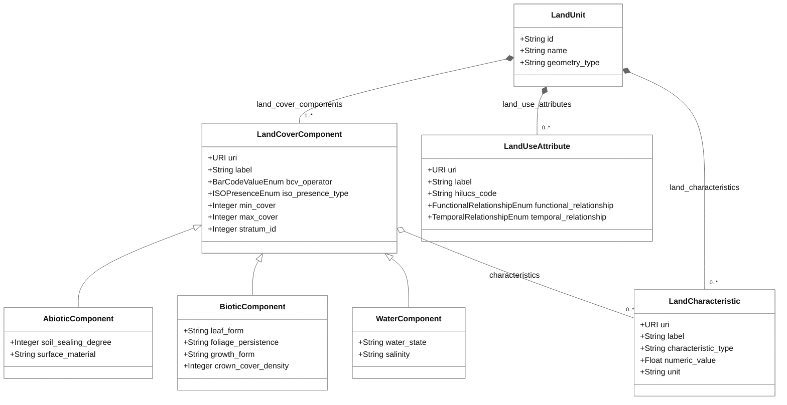
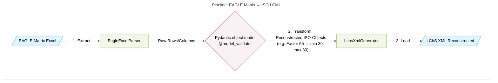
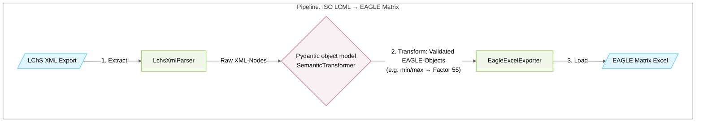
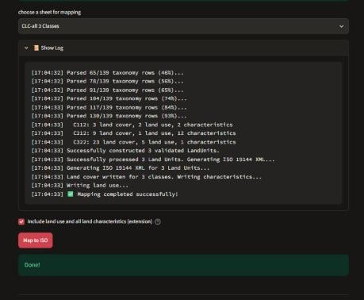

# Technical Report: Implementation of the EAGLE ↔ ISO 19144 Semantic Mapping Prototype

| Document Metadata | Details |
| :--- | :--- |
| **Contract Reference** | Service Contract No. `3506/R0-COPERNCA/EEA.60044` — Task 11: *Participation in the standardisation projects of ISO (ISO 19144-2, 19144-3 and 19144-4)* |
| **Implementing Partner** | Environment Agency Austria (EAA) — Task Manager: Gregor Rosenauer |
| **Contracting Authority** | European Environment Agency (EEA) — Task Lead: Ana Sousa |
| **Point of Origin** | Task 11 Specification ([`docs/spec.md`](spec.md)) & Initial Summary Report (*R. Grillmayer, EAA, 13/06/2025*) |
| **Software Artifact** | `eagle-iso-mapper` v0.2.0 (License: EUPL-1.2) |
| **Report Date** | 25 November 2026 |

---

## 1. Executive Summary

European and international land monitoring rely on two complementary, parametric frameworks for machine-readable land cover and land use characterisation:

1. **The EAGLE Concept (EEA / EIONET)**, which decomposes land classes into modular **Land Cover Components (LCC)**, **Land Use Attributes (LUA / HILUCS)**, and **Land Characteristics (LCH)**, operationalised across Copernicus Land Monitoring products (such as CLCplus Core) via the **EAGLE Barcoding Matrix** in Excel.
2. **The ISO 19144 Standard Series (ISO TC 211 / FAO)**, comprising **ISO 19144-2:2023 (LCML — Land Cover Meta Language)**, **ISO 19144-3:2024 (LUML — Land Use Meta Language)**, and the upcoming **ISO 19144-4 (Registration and Implementation Aspects)**, operationalised through the FAO **Land Characterisation System (LChS)** software and the **FAO Land Cover Legend Registry (LCLR)**.

Under Task 11 ([`docs/spec.md`](spec.md)), the core objective is to establish semantic interoperability between these two standards so that European nomenclatures can be documented in ISO-compliant form, registered in international registries, compared via automated similarity tools, and exchanged bidirectionally without manual re-encoding.

### What Was Delivered

This report documents the design, architectural evolution, and implementation of **`eagle-iso-mapper` (Prototype v0.2.0)** — an open-source, bidirectional transformation engine and interactive web application bridging EAGLE Excel barcoding matrices and ISO 19144 / FAO LChS `.lchs` XML files.

Key achievements include:

* **Standards-Driven, Declarative Architecture:** Replaced fragile, hardcoded conversion logic with a formal **LinkML** canonical domain model ([`eagle-iso-mapping.linkml.yaml`](../src/model/eagle-iso-mapping.linkml.yaml)) and a W3C/OBO **SSSOM** semantic crosswalk ([`eagle_iso_sssom.yaml`](../src/mapping/eagle_iso_sssom.yaml)).
* **Complete Land Cover Coverage:** All **55 EAGLE Land Cover Components** map to valid blocks of the official FAO LChS block library (39 explicit SSSOM rows plus deterministic nearest-ancestor inheritance), validated against the extracted FAO LChS profile (`fao_lchs_profile.json`).
* **Dual-Mode ISO Export (Plain LChS vs. Extended Profile):** Supports both a **plain LChS subset** (strictly aligned to what `lchs.fao.org` natively imports, including numeric `BlockID`/`CharacteristicID` joins and `.lchs` file extension) and a **structured project extension** carrying ISO 19144-3 Land Use (`LU_LandUse`), general land characteristics, and structured irrigation code lists.
* **Quantitative Stratum Balancing:** Enforces ISO 19144-2 cover semantics (min/max `<cover>` pairs and the 100% stratum cover invariant) while transparently flagging semantic ambiguities in EAGLE factors and Bar Code Values (BCVs).
* **Usable Web Interface & Live Governance:** A responsive Streamlit application (`app.py`) with single-sheet fast Excel ingestion (~2 s total run time on 2.3 MB workbooks), live progress logging, and an embedded YAML editor (`streamlit-ace`) enabling domain experts to inspect and update SSSOM mappings without modifying Python code.
* **Automated Quality Assurance:** Backed by a **66-test `pytest` suite** ([`tests/test_mapper.py`](../tests/test_mapper.py)) verifying forward/reverse mapping, round-trip fidelity on the CORINE benchmark classes (`CLC112`, `CLC212`, `CLC322`), FAO profile alignment, and cover-balancing edge cases.

### Traceability Against Task 11 Harmonisation Goals (`docs/spec.md`)

| Task 11 Goal (`docs/spec.md`) | Implementation Status in Prototype v0.2.0 |
| :--- | :--- |
| **1. Provision of ISO-compliant documentation** of European EAGLE-based nomenclatures | **Implemented.** Converts vertical EAGLE Excel matrices directly into relational ISO 19144-2 `.lchs` XML (both plain LCML and extended LCML+LUML). |
| **2. Registration in the FAO Land Cover Registry (LCLR)** | **Technically enabled.** Plain LChS output carries the native `.lchs` structure, FAO block names, presence types, and numeric IDs required by the FAO LChS tool for registry submission. *(Actual registration is out of scope — see Annex A.4).* |
| **3. Use of ISO-compliant nomenclatures** in EAGLE-based software (e.g., CLCplus Core) | **Implemented.** Reverse pipeline (`ISO ➔ EAGLE`) parses relational and hierarchical LChS XML back into matrix-ordered EAGLE Excel sheets with official Eionet URIs, labels, and hierarchy levels. |
| **4. Use of standard-compliant software** (FAO LChS) in the EAGLE context | **Implemented (LCML subset).** Output `.lchs` files align with the FAO LChS tool's `DataSources` vocabulary and ID join model. |
| **5. Comparability of land cover & land use nomenclatures** (e.g., LChS *Legend Connector*) | **Technically enabled.** Converting EAGLE legends into ISO LCML enables similarity calculation against global legends (e.g., SEEA, GlobCover) inside LChS. |
| **6. Semantic transformation tests & recommendations** | **Implemented & documented.** Benchmark classes (`CLC112`, `CLC212`, `CLC322`) tested end-to-end; concrete gaps and standard-revision proposals are documented in Sections 5 and 6. |

---

## 2. Background & Architectural Evolution

### 2.1 Point of Origin: Task 11 Spec & Early Proposal (June 2025)

The June 2025 Summary Report (*R. Grillmayer, EAA*) established the conceptual baseline for Task 11 by manually mapping three representative CORINE Land Cover classes from the Spatial Focus / CLCplus Core barcoding matrix into the FAO LChS tool:
* **`CLC112`**: *Discontinuous urban fabric (30–80% artificially sealed)*
* **`CLC212`**: *Permanently irrigated land (> 75% herbaceous crops (irrigated))*
* **`CLC322`**: *Moors and heathland*

That initial assessment surfaced two structural blockers to a traditional GIS transformation approach:
1. **Conceptual Divergence:** ISO 19144-2 (LCML) models land cover from a *vegetation-ecology* perspective (explicit vertical strata, biophysical growth forms, bounded cover intervals), whereas EAGLE adopts a *remote-sensing* perspective (flat barcoding matrix with logical operators `BCV 1–5, X` and single-value factors).
2. **Absence of Official XML Schemas (XSD):** The early proposal envisioned a UML-to-XSD derivation for EAGLE legends paired with **XSLT** transformations between ISO XML and EAGLE XML. However, neither ISO 19144-3 (LUML) nor an EAGLE *legend* model (as opposed to EAGLE data instances) possesses a published official XSD. Relying on XSLT would therefore have stalled implementation indefinitely.

### 2.2 Architectural Pivot: From XSLT to LinkML + SSSOM

Rather than waiting for formal UML/XSD artifacts or hardcoding brittle XML-to-Excel scripts, the implementation evolved across two prototype iterations into a **declarative, model-driven semantic architecture**:

| Dimension | Early Proposal (June 2025) | Prototype 1 (June 2026 PoC) | Prototype 2 (Oct–Nov 2026, Current) |
| :--- | :--- | :--- | :--- |
| **Transformation Paradigm** | UML ➔ XSD ➔ XSLT | Custom LinkML (CORINE-only) + manual alias YAML | **Generic LinkML domain model + official SSSOM crosswalk (`sssom-py`)** |
| **Scope** | Manual LCML mapping of 3 CLC classes in LChS UI | Automated LCC-only mapping (7 hardcoded labels) | **Full LCC (55 concepts), LUA (HILUCS), LCH (incl. irrigation & species)** |
| **XML Target Format** | Conceptual LChS diagrams | Simplified custom hierarchical XML (`<lchs:Export>`) | **Native FAO LChS relational `.lchs` XML** (with numeric IDs) + optional ISO-style extensions |
| **Validation & Typing** | Manual inspection | Basic Pydantic generation | **Compiled Pydantic v2 models + 66 automated `pytest` checks** |
| **Maintainability** | Requires XSLT / XSD expertise | Requires editing Python code | **Domain experts edit YAML crosswalks live in the Web UI** |

**Why LinkML + SSSOM?**
* **LinkML (Linked Data Modeling Language)** provides an encoding-independent conceptual schema ([`eagle-iso-mapping.linkml.yaml`](../src/model/eagle-iso-mapping.linkml.yaml)) that automatically compiles to strongly typed Python/Pydantic v2 classes (`gen-pydantic`), JSON-LD contexts, and documentation—serving as the single source of truth without requiring an external XSD.
* **SSSOM (Simple Standard for Sharing Ontological Mappings)** formalizes the crosswalk ([`eagle_iso_sssom.yaml`](../src/mapping/eagle_iso_sssom.yaml)) using W3C SKOS predicates (`skos:exactMatch`, `skos:closeMatch`, `skos:broadMatch`) and provenance metadata (`semmatch:ManualMappingCuration`, `semmatch:LogicalReasoning`). Every semantic decision is explicit, machine-readable, and auditable.

---

## 3. System Architecture & Implementation

The prototype is structured into four decoupled layers:

*Figure 1: End-to-end bidirectional transformation architecture between ISO 19144 (LCML) and EAGLE Matrix Excel (source: [`diagrams/bidi-transformation-graph.svg`](diagrams/bidi-transformation-graph.svg)).*

### 3.1 Canonical Domain Model (LinkML)
Defined in [`src/model/eagle-iso-mapping.linkml.yaml`](../src/model/eagle-iso-mapping.linkml.yaml) and compiled on startup by [`run.py`](../run.py) into [`src/python/generated/eagle_iso_models.py`](../src/python/generated/eagle_iso_models.py), the canonical model centres on `LandUnit` (representing a legend class or spatial unit):
* **`LandCoverComponent`** (specialised into `AbioticComponent`, `BioticComponent`, `WaterComponent`): holds `uri`, `code`, `label`, `bcv_operator` (`BarCodeValueEnum`), `iso_presence_type` (`ISOPresenceEnum`), `min_cover`, `max_cover`, and `stratum_id`.
* **`LandUseAttribute`**: holds `uri`, `code`, `label`, `hilucs_code`, `iso_function_type`, `bcv_operator`, `iso_presence_type`, `functional_relationship`, and `temporal_relationship`.
* **`LandCharacteristic`**: holds `uri`, `code`, `label`, `bcv_operator`, `iso_presence_type`, `characteristic_type`, `numeric_value`, and `unit`.

*Figure 2: Canonical LinkML class diagram (`LandUnit` and its LCC/LUA/LCH components). Pre-rendered SVG for Word export: [`diagrams/linkml_class-diagram.svg`](diagrams/linkml_class-diagram.svg) (source: [`diagrams/linkml-class-diagram.mermaid`](diagrams/linkml-class-diagram.mermaid)).*

### 3.2 Semantic Crosswalk Engine (`src/mapping/sssom_engine.py`)
Powered by the official `sssom` Python library (`MappingSetDataFrame`), `SSSOMResolver` manages bidirectional concept resolution:
* **Code-Based Identity:** Crosswalk subjects use stable code CURIEs (`eagle:LCC-1_1_1`, prefix `https://w3id.org/eagle/code/`), cleanly separated from the slug-based Eionet Data Dictionary URIs carried in Column A of the matrix. Resolution operates strictly on **code prefixes** rather than fragile label substrings (eliminating earlier false positives such as matching *"No Irrigation"* as irrigation or *"workshops"* as *"hops"*).
* **Nearest-Ancestor Fallback:** The crosswalk explicitly maps 39 LCC concepts; the remaining 16 finer EAGLE concepts automatically inherit their nearest mapped ancestor (e.g., *Boulders* `LCC-1_2_2_1_1` ➔ *Mineral Fragments* `LCC-1_2_2_1` ➔ `LC_CoarseMineralFragments`).
* **Authoritative Vocabulary Alignment:** Every crosswalk target is validated by automated tests against the extracted FAO LChS block library ([`src/mapping/fao_lchs_profile.json`](../src/mapping/fao_lchs_profile.json)) and every exported EAGLE row pulls its official Eionet URI, label, and hierarchy level from [`src/mapping/eagle_concepts.json`](../src/mapping/eagle_concepts.json).

### 3.3 Forward Pipeline: EAGLE Excel ➔ ISO 19144 `.lchs` (`src/mapping/eagle_to_iso.py`)
* **Fast Single-Sheet Ingestion:** Full `openpyxl` loading of the 2.3 MB EAGLE workbook previously took 15–27 s. The parser now inspects sheet headers in read-only mode to list only valid barcoding sheets (containing `Class Code` headers, filtering out horizontal taxonomy diagrams) and loads only the selected sheet's values (`load_matrix`, ~0.5 s), completing a full run in ~2 seconds.
* **Relational LChS XML Generation:** `LchsXmlGenerator` constructs the native relational XML tree (`LC_Legend` ➔ `objects` ➔ `LC_Class`, `LC_HorizontalPatterns`, `LC_Strata`, `LC_Properties`, `LC_Characteristics`, and optionally `LU_LandUse`), populating the numeric `BlockID` and `CharacteristicID` fields from [`src/mapping/fao.py`](../src/mapping/fao.py) that the FAO LChS software uses for internal joins.

*Figure 3: EAGLE Excel ➔ ISO 19144 `.lchs` transformation pipeline. Pre-rendered SVG for Word export: [`diagrams/eagle-to-iso.svg`](diagrams/eagle-to-iso.svg) (source: [`diagrams/eagle-to-iso.mmd`](diagrams/eagle-to-iso.mmd)).*

### 3.4 Reverse Pipeline: ISO 19144 `.lchs` / XML ➔ EAGLE Excel (`src/mapping/iso_to_eagle.py`)
* **Dual-Format XML Parsing:** `LchsXmlParser` auto-detects and parses both official relational LChS XML and flat hierarchical XML (`LegendClass`), stripping namespaces for resilience.
* **Lossless Extension Round-Trip:** Reads both plain FAO `.lchs` files and extended `.lchs` files (restoring `LU_LandUse`, `LC_Characteristics` with `CharacteristicCode`, exact `EagleCode` concepts, and exact `EagleBcv` values 4 and 5). Unmatched ISO blocks receive dedicated matrix rows (`LCC-Custom-<BlockName>`) rather than colliding.
* **Matrix-Ordered Excel Export:** `EagleExcelExporter` generates a formatted vertical EAGLE barcoding sheet with standard headers, Eionet URIs, official labels, levels, and numeric factors, sorted in canonical EAGLE matrix order (section ➔ numeric code segments, keeping parent concepts directly above their children).

*Figure 4: ISO 19144 `.lchs` ➔ EAGLE Matrix Excel transformation pipeline. Pre-rendered SVG for Word export: [`diagrams/iso-to-eagle.svg`](diagrams/iso-to-eagle.svg) (source: [`diagrams/iso-to-eagle.mmd`](diagrams/iso-to-eagle.mmd)).*

### 3.5 Interactive Web Application (`app.py`)
Built with Streamlit (`>=1.67.0`), the web UI exposes three workspaces:
1. **EAGLE ➔ ISO Tab:** Workbook upload, automatic barcoding sheet detection, a toggle for *Include land use and all land characteristics (extension)* vs. plain LChS subset, live progress bar and 40-line rolling log, and `.lchs` download.
2. **ISO ➔ EAGLE Tab:** `.lchs` / `.xml` upload, well-formedness validation, fuzzy-matching and parser-mode controls, and `.xlsx` download.
3. **Mapping & Schema Config Tab:** Displays the live SSSOM DataFrame alongside a syntax-highlighted `streamlit-ace` YAML editor (inside a form to prevent rerun flicker) that validates, persists, and hot-reloads `eagle_iso_sssom.yaml`, plus a read-only viewer for the active LinkML schema.

*Figure 5: EAGLE ➔ ISO conversion workspace with sheet selector and extension toggle.*

*Figure 6: Real-time progress and semantic warning log during a 2.3 MB workbook transformation.*

*Figure 7: Embedded SSSOM crosswalk table and syntax-highlighted YAML editor enabling domain-expert curation without code changes.*

---

## 4. Semantic Challenges Addressed & Technical Findings

Testing the prototype against the CORINE benchmark classes and the live FAO LChS tool resolved several key semantic and technical challenges identified in [`docs/spec.md`](spec.md) and the June 2025 report (detailed further in [`docs/mapping.md`](mapping.md)):

### 4.1 Bar Code Values (BCV) ↔ ISO Presence Types
The FAO LChS tool recognises exactly four element presence types: `Fixed`, `Conditional Temporal`, `Exclusive`, and `Precluded` (note: there is no plain `Conditional` in the tool's own exports).

| EAGLE BCV | EAGLE Semantics | ISO 19144-2 / FAO LChS Presence Type | Semantic Fidelity Note |
| :--- | :--- | :--- | :--- |
| **`3`** | Cumulative mandatory (`AND`) | `Fixed` | 1:1 semantic match. |
| **`1`** | Optional / typical occurrence | `Conditional Temporal` | Follows FAO LChS reference exports (e.g., CLC322); does not imply temporal-only semantics. |
| **`2`** | Selective mandatory (`EITHER-OR`) | `Exclusive` | Maps to disjunctive alternatives. |
| **`4`** | Paired mandatory (at least two) | `Exclusive` *(plain)* / `EagleBcv=4` *(ext.)* | Minimum-of-two constraint is not natively expressible in LCML. |
| **`5`** | Exclusive mandatory (`NOTHING-BUT`) | `Exclusive` *(plain)* / `EagleBcv=5` *(ext.)* | Collapses to `2` in plain LChS; preserved losslessly via `EagleBcv` in extended mode. |
| **`X`** | Explicitly excluded | `Precluded` | Preserved across LCC, LUA, and LCH; assigned `0–0%` cover. |

*Finding:* Plain LChS cannot distinguish BCV 2, 4, and 5 upon reverse mapping. The mapper explicitly logs this loss per class and provides `EagleBcv` in extension mode to guarantee lossless round-tripping.

### 4.2 Cover Ranges, EAGLE Factors & The 100% Stratum Rule
* **XML Encoding:** ISO 19144-2 models cover as a range; FAO LChS serialises it as two repeated `<cover>` tags (min, max), not `<minCoverage>`/`<maxCoverage>`.
* **Factor Ambiguity:** As flagged in the June 2025 report, EAGLE stores only a single midpoint *Factor* (e.g., `0.55` for `30–80%`, `0.875` / `0.75` for `75–100%`), losing interval width. The prototype maps only verified intervals and leaves unknown factors (such as `0.5`, `0.375`, or default `1.0`) as open `0–100%` ranges with a log warning rather than fabricating artificial bounds.
* **Stratum Balancing ([`src/mapping/cover.py`](../src/mapping/cover.py)):** Because all elements of a class share one stratum, the balancer enforces $\sum \text{min} \le 100 \le \sum \text{max}$:
  * Precluded elements are fixed to `(0, 0)`.
  * Only leaf (most specific) active elements are summed (preventing double-counting of e.g. *Vegetation* alongside *Graminoids*).
  * Exclusive alternatives contribute only the largest single minimum.
  * Minima exceeding 100% are scaled down proportionally with a warning; maxima below 100% are logged without inventing cover.

### 4.3 Land Use, Characteristics & Irrigation Extension
Because ISO 19144-3 (LUML) is not yet implemented in LChS and ISO 19144-2 lacks standardised code lists for irrigation methods, water sources, or general EAGLE characteristics, the prototype implements a clean **project extension** ([`src/mapping/eagle_iso_extensions.yaml`](../src/mapping/eagle_iso_extensions.yaml), UML in [`docs/diagrams/irrigation-extension.puml`](diagrams/irrigation-extension.puml)):
* **Land Use:** Written as `LU_LandUse` carrying `LandUseCode`, `hilucsCode`, `LandUseLabel`, `LandUseURI`, `elementPresenceType`, `functionalRelationship`, and `temporalRelationship`.
* **Land Characteristics:** Classified by longest EAGLE code prefix into five typed classes: `LC_IrrigationCharacteristic`, `LC_WaterRegimeCharacteristic`, `LC_CultivationCharacteristic`, `LC_ManagementCharacteristic`, and `LC_GeneralCharacteristic` (added because most of the 787 EAGLE characteristics fall outside the four domain-specific classes), while rice (*Oryza sativa*) and hops (*Humulus lupulus*) remain `LC_FloristicAspectsCharacteristic`.
* **Irrigation Code Lists:** Defines ISO-style `IrrigationType` (including `gravitySurface`, `manual`, `unspecified` for lossless EAGLE mapping), `WaterSource`, and `IrrigationRegime`. In **plain LChS mode**, these automatically collapse to the FAO tool's three native values (`Surface`, `Sprinkler`, `Drip`).

### 4.4 FAO LChS Tool (`lchs.fao.org`) Interoperability Findings
Direct inspection of the FAO LChS tool revealed three critical implementation requirements:
1. **File Extension Matters:** The tool selects its importer by extension. `.lchs` triggers the native relational importer; `.xml` triggers a legacy translator that fails with *"no translator available for XML"*. Downloads therefore use `.lchs`.
2. **Numeric ID Joins:** The tool joins `LC_Properties` and `LC_Characteristics` to its internal block library by numeric `BlockID` and `CharacteristicID`, not by `BlockReference` string. Without these IDs (now injected via `fao_lchs_profile.json`), classes load empty.
3. **Biotic Attachment:** Characteristics (irrigation, floristic species) must attach to a vegetation block; attaching them to abiotic blocks is rejected by LChS.

---

## 5. Verification & Quality Assurance

The prototype is verified by an automated **`pytest` suite of 66 tests** in [`tests/test_mapper.py`](../tests/test_mapper.py) covering:
* **Crosswalk & Vocabulary Integrity:** Verifies every SSSOM row against the shared EAGLE vocabulary and the FAO LChS block library; ensures all 55 LCC concepts resolve to a valid FAO block and every exported row carries its official Eionet URI, label, and matrix order.
* **Semantic Rules & Edge Cases:** Tests BCV 1–5/X mappings, `Precluded` handling, factor-to-cover conversion, unknown factor warnings, stratum 100% balancing (scaling, leaf-only summation, exclusive alternatives), and code-prefix vs. label disambiguation.
* **FAO LChS Compatibility:** Confirms numeric `BlockID`/`CharacteristicID` attachment, FAO presence type compliance, and plain LChS subset filtering (3 irrigation types, no extension leakage).
* **End-to-End Round-Trips:** Validates full `Excel ➔ .lchs ➔ Excel` and `FAO sample .lchs ➔ Excel` transformations on `CLC112`, `CLC212`, and `CLC322`, plus equivalence between fast single-sheet loading and full workbook loading.

---

## 6. Recommendations for EAGLE & ISO 19144 Standardisation

In line with the *Recommendations* section of [`docs/spec.md`](spec.md), implementation of the prototype yields the following actionable inputs for the EAGLE Group and ISO TC 211 / AG 13:

### 6.1 Recommendations for the EAGLE Model & Matrix
1. **Replace or Formalise the Factor Column:** The single-value `Factor` column (not formally specified in Bar-Coding Manual D3-1a) causes irreversible loss of min/max interval widths. EAGLE should either publish an authoritative factor-to-interval lookup table or adopt explicit `Min Cover %` / `Max Cover %` columns.
2. **Clarify BCV 4 & BCV 5 Exchange Semantics:** Provide guidance on how paired mandatory (`BCV 4`) and exclusive mandatory (`BCV 5`) constraints should be downgraded or annotated when targeting ISO 19144-2 (`Exclusive`).
3. **Review Land-Use Characteristics in LCH:** As initially noted in the June 2025 report and confirmed during extension design, agricultural management characteristics such as *Arable Crop Land* (`LCH-5_1_1_1_1`) and *Crop Rotation* (`LCH-5_1_2_1`) semantically belong to land use (ISO 19144-3) rather than biophysical land cover; separating them in future EAGLE revisions will simplify ISO alignment.
4. **Publish Stable Concept Codes Alongside Eionet URIs:** Maintain a machine-readable JSON/LinkML release of the EAGLE vocabulary mapping stable codes (`LCC-1_1_1`) to Eionet slug URIs and hierarchy levels.

### 6.2 Recommendations for ISO 19144 (Parts 2, 3, 4) & FAO LChS
1. **Publish Official Encoding Schemas (XSD / JSON Schema / LinkML):** Provide normative, versioned exchange schemas for ISO 19144-2 and ISO 19144-3 (LUML) under ISO 19144-4 so implementers do not have to reverse-engineer `.lchs` exports.
2. **Standardise Extensible Irrigation & Management Code Lists:** Adopt structured code lists (`IrrigationType`, `WaterSource`, `IrrigationRegime`) into ISO 19144-2 / 19144-4 registries to support European agricultural monitoring without proprietary extensions.
3. **Integrate ISO 19144-3 (LUML) into FAO LChS:** Extend the LChS software to natively store and export land use classes (e.g., mapped to HILUCS) alongside LCML strata.
4. **Address LChS Tool Constraints:** Fix the `0..*` cardinality limitation on floristic species in LChS (currently requiring array workarounds) and decouple `.lchs` imports from undocumented internal numeric IDs (`BlockID` drift between versions, e.g., `LC_BareSoil` changing from `1030` to `1029`).

---

## Annex: Remaining & Out-of-Scope Items (Covered Separately)

The following operational, governance, domain-validation, and standardisation items lie outside the scope of the current software prototype and will be addressed in separate follow-up work packages:

### A.1 Deployment, Hosting & Operational Handover
* **Production Deployment & Containerisation:** Packaging the application (e.g., Docker / OCI container) for deployment in EEA / EIONET or national agency infrastructure, including environment hardening, HTTPS/reverse-proxy configuration, and optional authentication.
* **CI/CD & Release Management:** Setting up automated GitHub Actions / GitLab CI pipelines for continuous `pytest` execution, LinkML schema validation, and tagged semantic releases.
* **Formal Code & Operations Handover:** Transferring repository ownership/maintenance workflows under EUPL-1.2, operational runbooks, and dependency update procedures (`uv`, Python 3.13+, `sssom`, `linkml`).

### A.2 Training, Capacity Building & User Onboarding
* **Domain Expert & GIS Specialist Trainings:** Hands-on workshops for EEA, EIONET, and national land-monitoring teams on operating the web app, interpreting stratum/BCV logs, and curating the SSSOM YAML crosswalk without developer support.
* **End-User Materials:** Creating step-by-step onboarding guides, video walkthroughs, and FAQ documentation tailored to non-technical nomenclature editors.

### A.3 Unverified Technical & Domain Open Points (Require Expert Sign-Off)
* **Live FAO LChS Import Testing of Extensions:** While the plain LChS subset is aligned to `fao_lchs_profile.json` and `.lchs` conventions, importing files containing the project extension elements (`LU_LandUse`, `LC_GeneralCharacteristic`, `EagleCode`, `EagleBcv`) into `lchs.fao.org` has not yet been tested end-to-end.
* **EAGLE Expert Confirmation of Semantic Interpretations:**
  * Confirming the **100% stratum cover rule** in [`src/mapping/cover.py`](../src/mapping/cover.py) (specifically counting conditional minima and treating exclusive elements as single alternatives).
  * Confirming the mapping of **BCV 1 ➔ `Conditional Temporal`** and **BCV 4 / 5 ➔ `Exclusive`**.
  * Reviewing all `skos:closeMatch` and `skos:broadMatch` judgements in [`eagle_iso_sssom.yaml`](../src/mapping/eagle_iso_sssom.yaml) (e.g., *Open Sealed Surfaces* ➔ `LC_NonBuiltUpSurface`).
  * Supplying the complete **EAGLE Factor table** (currently only `0.55` and `0.875`/`0.75` have confirmed intervals; `0.5`, `0.375`, and `1.0` remain open).
  * Formally agreeing on the element and code-list names in the **project extension** (`LU_LandUse`, `LC_GeneralCharacteristic`, `IrrigationType`, `WaterSource`, `IrrigationRegime`) before external file exchange.

### A.4 Broader Task 11 Standardisation & Registry Activities
* **ISO Governance Participation:** Attendance and contributions to ISO TC 211 Plenaries, Advisory Group 13 (Land Cover & Land Use) meetings, and the ISO 19144-4 editing committee.
* **Official FAO Registry Publication:** Formal submission, review, and publication of transformed European nomenclatures (CORINE Land Cover, CLCplus Core) into the **FAO Land Cover Legend Registry (LCLR)**.

### A.5 Future Technical Enhancements (Post-Prototype Roadmap)
* **Headless Batch CLI / REST API:** Exposing the mapping engine as a headless service or CLI for automated integration into Copernicus / CLCplus Core data pipelines.
* **Multi-Stratum Support:** Extending the forward mapper beyond single-stratum classes where vertical layering (e.g., agroforestry / orchard canopy over herbaceous understory) is explicitly encoded.
* **Normative ISO 19144-3 Adoption:** Replacing the provisional `LU_LandUse` extension with the official ISO 19144-3 (LUML) encoding once published and supported by LChS.
* **Tighter Integration with `eagle-eye`:** Connecting the companion text-analysis prototype (`eagle-eye`, which extracts EAGLE codes from free-text class descriptions) directly into the `eagle-iso-mapper` pipeline for end-to-end *Text ➔ EAGLE ➔ ISO 19144* workflows.
